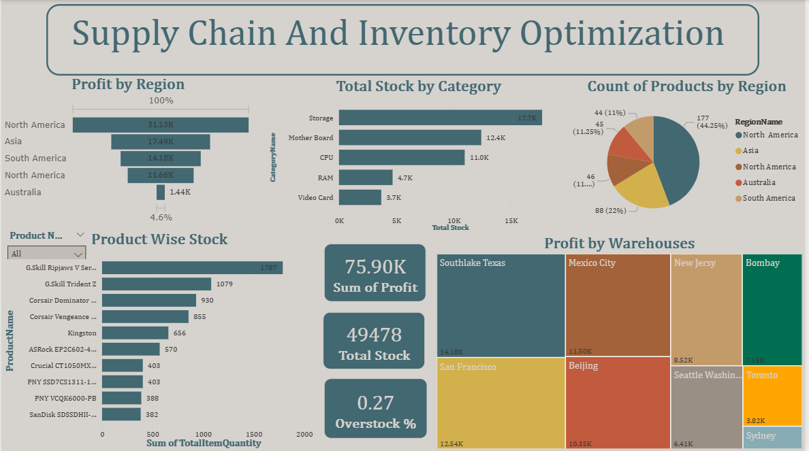

# Supply Chain & Inventory Optimization Dashboard (Power BI)

A Power BI dashboard that shows **where stock sits, which warehouses and regions earn the most profit, and how much inventory is overstocked**.

## Business questions
- How much stock do we hold, and in which product categories?
- Which regions and warehouses generate the most profit?
- Which products hold the most stock, and is any of it overstocked?

## Dataset
400 order lines | 275 products | 5 categories (Storage, Mother Board, CPU, RAM, Video Card) | 9 warehouses | 4 regions
Fields include product cost, list price, profit, order status, order quantity and stock quantity.

## Dashboard

**KPIs:** total profit (75.9K), total stock (49,478 units), overstock %
**Visuals:** profit by region, stock by category, product-wise stock (with product filter), profit by warehouse, product count by region

## Key findings
- **North America generates most of the profit** (42.8K of 75.9K) and holds most of the products.
- **Storage is the largest stock category** (17.7K units), followed by Mother Boards (12.4K).
- **Southlake Texas is the most profitable warehouse** (14.2K), followed by San Francisco and Mexico City.
- **28% of orders were cancelled** (111 of 400), which is worth investigating.

## Data quality note
The raw data spells one region two ways (`North America` and `North  America` with a double space), so it shows up twice in the charts. Fix in Power Query: select `RegionName` > **Transform** > **Format** > **Trim**, then replace the double space with a single space.

## How to open
Open `dashboard/Supply_Chain_Inventory_Optimization.pbix` in Power BI Desktop. If prompted, point the data source to `data/supply_chain_data.csv`.

## Tools
Power BI · DAX · Power Query
